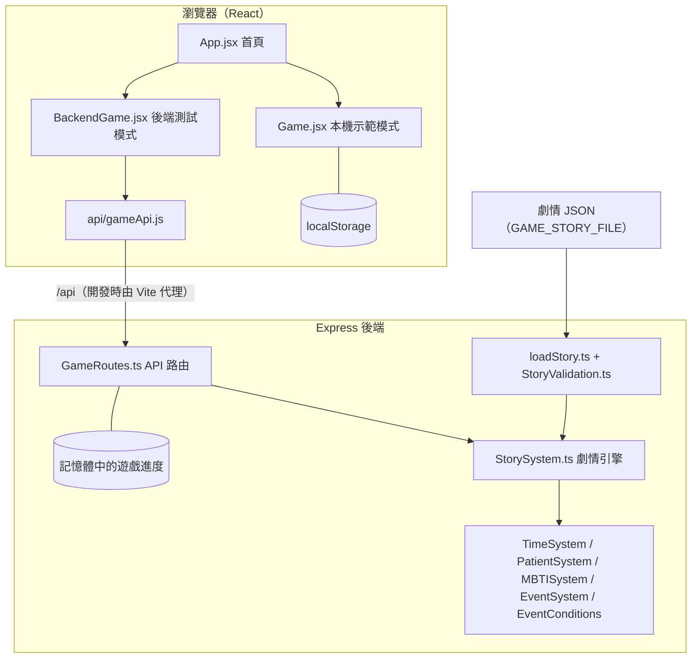

<div align="center">

# 植心溫室

**在 21 天裡，陪伴三位病患慢慢找回自己的互動劇情遊戲**

每一天的選擇，都會影響病患的信任與治癒，也悄悄描繪出你自己的性格。

[](#開發進度)
[](https://react.dev/)
[](https://vite.dev/)
[](https://www.typescriptlang.org/)
[](https://expressjs.com/)

[遊戲介紹](#遊戲介紹) · [快速開始](#快速開始) · [核心玩法](#核心玩法) · [技術架構](#技術架構) · [專案結構](#專案結構) · [開發進度](#開發進度) · [文件](#團隊文件)

</div>

> [!IMPORTANT]
> **目前為遊戲系統原型，尚不能完整遊玩正式劇情。**
> 後端遊戲規則與劇情引擎、前後端 API 串接已完成；正式劇情、第 15 天危機內容、結局與評分尚未製作。
> 專案內的劇情資料（`frontend/src/stories/`、`backend/stories/`）都是**測試用範例**，不是正式故事。

---

## 遊戲介紹

### 故事背景

依據[課程專題提案](docs/PROJECT_PROPOSAL.md)，玩家將扮演一名新入職的**「植心師」**，踏入一座隱蔽的療養院。這裡的患者會將心理創傷具象化為奇異植物；玩家需要在有限的時間裡安排治療、建立信任，並承擔每個選擇帶來的後果。

> 當你能治好一個人，卻未必能真正理解他，你會怎麼選？

### 設計核心

- **把創傷變得可見**：以植物象徵心理創傷，透過外在變化表現角色的內心狀態。
- **治療不只有一種答案**：治癒與信任分別衡量，呈現專業處置與情感理解可能不同步。
- **讓選擇承擔代價**：玩家需要分配有限的每日行動點，也可能因忽略患者而錯過重要事件。

提案預計包含**三位核心患者的專屬事件、多種結局與適性報告**，並提及「滿月危機」的劇情構想。這些是**提案目標，並非已完成的正式遊戲內容**；「滿月危機」是否對應現有後端的第 15 天強制事件，仍須由團隊討論確認。

目前程式原型採用 21 天遊戲流程，但原始提案未明確訂定遊戲總天數。詳細的[原訂組員分工與時程](docs/TEAM_PLAN.md)、[提案與實作差異](docs/PROPOSAL_GAPS.md)及[決策紀錄](docs/DECISIONS.md)均已另行保存。

---

## 快速開始

需要 Node.js **20.19 以上**、npm 與 Git。以下指令皆在專案根目錄以 **Windows PowerShell** 執行。

```powershell
# 1. 安裝相依套件
npm install

# 2. 指定深度劇情測試範本（只在目前的 PowerShell 視窗有效）
$env:GAME_STORY_FILE = (Resolve-Path backend/stories/depth.example.json).Path

# 3. 同時啟動前端（Vite）與後端（Express）
npm run dev
```

| 服務 | 網址 |
| --- | --- |
| 遊戲網頁 | <http://127.0.0.1:5173/> |
| 後端健康檢查 | <http://127.0.0.1:3001/api/health> |

按 `Ctrl+C` 結束。開啟網頁後，在首頁選擇「後端測試模式」→「建立新遊戲」即可操作後端進度。

- 不設定 `GAME_STORY_FILE` 時，可改用 `$env:ENABLE_GAME_DEMO = '1'` 載入只有一個測試互動的最小示範。兩者都沒設定時，遊戲端點回傳 `503 story_unconfigured`，本機示範模式仍可使用。
- 清除環境變數：`Remove-Item Env:GAME_STORY_FILE`。後端也會讀取 `backend/.env`（參考 `backend/.env.example`，不要提交 `.env`）。
- 只啟動後端：`npm start`。

### 測試與檢查

```powershell
npm run build                              # 前端正式建置
npm run typecheck --workspace backend      # 後端型別檢查
npm test --workspace backend               # 後端測試
npm test --workspace frontend              # 前端回歸測試
npm run story:validate --workspace backend -- ./stories/depth.example.json   # 驗證劇情 JSON
```

`story:validate` 的相對路徑以 `backend/` 為基準，也可使用絕對路徑。

後端測試包含以 `backend/stories/day-1-21.fixture.json` 走完第 1～21 天的 HTTP API 整合測試。如需在後端測試模式手動走一次，可在啟動前將 `GAME_STORY_FILE` 指向此檔。每個一般日用完 AP 後換日，第 15 天選擇「標記第 15 天測試事件完成」即可繼續。

<details>
<summary><strong>用 depth.example.json 走一次深度劇情</strong></summary>

1. 依上方指令設定 `GAME_STORY_FILE` 並執行 `npm run dev`。
2. 首頁按「後端測試模式」→「建立新遊戲」。
3. 第 1～3 天：每天選五次「測試互動」，AP 歸零後按「下一天」。
4. 第 4 天：前四次選「測試互動」，最後一次選「測試超過信任門檻」（病患 A 信任值 0→51），再按「下一天」。
5. 第 5 天會進入「病患 A 的深度劇情測試」：選「繼續」後按「完成深度劇情」，畫面回到每日互動節點，AP 仍為 5。

此範本**沒有** `finishCrisis` 選項，因此玩到第 15 天會停在「請先完成第 15 天強制事件」，無法進入第 16 天。這是範本內容不足，不是程式錯誤。

</details>

---

## 核心玩法

玩家在 21 天內，每天以有限的行動點（AP）與三位病患互動。

| 元素 | 說明 |
| --- | --- |
| **21 天** | 第 1 天開始，第 21 天後無法再換日 |
| **行動點 AP** | 每天 5 點；自由互動（`interaction`）消耗 1 點，對話（`dialogue`）不消耗；第 15 天為 0 |
| **三位病患** | 病患 A、B、C 各有**信任值**與**治癒值**，範圍 0～100 |
| **MBTI** | E/I、S/N、T/F、J/P 八個傾向依選擇累積分數，第 15 天起鎖定 |
| **深度劇情** | 第 4～14 天，病患數值跨過 50 時，隔天開啟該病患的深度劇情 |
| **第 15 天** | 強制事件日：不能自由行動，完成強制事件才能進入第 16 天 |

### 規則狀態

已寫入程式的規則分為兩類：團隊**已確認**的規則，以及依企劃提案實作、**仍屬暫定**的行為。完整清單見 [決策紀錄](docs/DECISIONS.md)。

| 規則 | 狀態 |
| --- | --- |
| 第 4～14 天信任值或治癒值由 ≤50 變為 >50，記錄隔天的深度劇情 | 已確認 |
| 隔天恰好一位病患到期、且劇情有設定入口時，才進入深度劇情 | 已確認 |
| 深度劇情不消耗 AP，完成後回到原劇情節點，同一病患不重複 | 已確認 |
| 換日後依 `dayStarts` 切換入口；同日觸發深度劇情時，完成後返回新一天的日常節點 | 暫定（[Issue #14](https://github.com/wuguanyou/Story_game/issues/14)，待團隊確認） |
| 第 15 天鎖定 MBTI、AP 為 0、不能自由行動 | 已確認 |
| 第 15 天強制事件完成前，不能進入第 16 天 | 已確認 |
| 遊戲共 21 天、每天 AP 5 | 暫定 |
| 以「用完當天 AP」作為換日條件 | 暫定 |
| 病患數值範圍 0～100、MBTI 只累加非負分數 | 暫定 |
| 以 `finishCrisis` 選項標記第 15 天強制事件完成 | 暫定 |

---

## 技術架構

| 層級 | 技術 | 位置 |
| --- | --- | --- |
| 前端 | React 19、Vite 6 | `frontend/` |
| 後端 | Express 5、TypeScript（以 `tsx` 執行） | `backend/` |
| 前端測試 | Vitest、jsdom、Testing Library | `frontend/src/**/*.test.jsx` |
| 後端測試 | Node.js 內建測試執行器（`tsx --test`） | `backend/src/game/*.test.ts` |
| 套件管理 | npm workspaces | 根目錄 `package.json` |



後端進度只存在伺服器記憶體（最多 100 局，重啟即清除），目前沒有資料庫。

### 前端的兩種模式

| | 本機示範模式 | 後端測試模式 |
| --- | --- | --- |
| 入口 | 「開始示範劇情」「讀取本機存檔」 | 「後端測試模式」 |
| 劇情來源 | `frontend/src/stories/` 的靜態中性示範 | 後端載入的劇情 JSON |
| 遊戲規則 | 無，只有分支跳轉 | 由後端判斷 AP、換日、深度劇情、第 15 天 |
| 進度保存 | 瀏覽器 localStorage（手動存檔） | 只在 React 記憶體；重新整理或後端重啟後需重新建立 |
| 用途 | 介面與分支流程示範 | 驗證後端規則與 API 串接 |

後端測試模式會顯示 Day、AP、MBTI 鎖定狀態、目前深度劇情，以及病患信任值與治癒值。「下一天」按鈕的啟用條件只是提示，最終一律由後端驗證。

<details>
<summary><strong>API 端點</strong></summary>

| 方法 | 路徑 | 用途 |
| --- | --- | --- |
| GET | `/api/health` | 健康檢查 |
| POST | `/api/games` | 建立新局（201） |
| GET | `/api/games/:id` | 讀取進度 |
| POST | `/api/games/:id/actions` | `choose`（需 `choiceId`）、`advanceDay`、`finishDepth`，皆需帶目前的 `revision` |

每次成功操作 `revision` 加 1；送出舊版本號會回傳 `409 stale_revision`。其他錯誤包含 `409 choice_unavailable`、`409 day_unavailable`、`409 depth_unavailable`、`400 invalid_action`、`404 game_not_found`、`503 story_unconfigured`。

請求與回應格式詳見 [後端 API 說明](docs/BACKEND_GAME_API.md)。

</details>

<details>
<summary><strong>劇情資料格式</strong></summary>

正式劇情以**後端劇情 JSON** 交付，由 `GAME_STORY_FILE` 載入，啟動時會完整驗證。

```json
{
  "start": "daily",
  "depthStarts": { "A": "depth_a" },
  "nodes": [
    {
      "id": "daily",
      "text": "每日互動測試。",
      "choices": [
        { "id": "practice", "label": "測試互動", "next": "daily", "action": "interaction" }
      ]
    }
  ]
}
```

| `action` | 意義 |
| --- | --- |
| `interaction` | 自由行動，消耗 1 AP；AP 為 0 或第 15 天時不會出現 |
| `dialogue` | 對話，不消耗 AP；深度劇情中只會顯示此類選項 |
| `finishCrisis` | 標記第 15 天強制事件完成，只在第 15 天可用、只能完成一次 |

選項可加上 `condition`（`day`、`slot`、`patient`、`flag`、`lockedPreference`、`all`、`any`）與 `effect`（`patient`、`mbti`）。只能使用驗證器支援的欄位，完整說明與交付流程見 [劇情編寫指南](docs/STORY_GUIDE.md)。

第 1 天從 `start` 開始。可用 `dayStarts` 指定第 2～21 天的入口，例如 `"dayStarts": { "2": "day_02", "15": "day_15" }`，每個值須是已存在的節點 ID。成功換日後，有設定就切換到當天入口，否則延續當前節點。若觸發深度劇情，完成後會回到換日選定的日常節點。

</details>

<details>
<summary><strong>主要程式碼位置</strong></summary>

| 內容 | 位置 |
| --- | --- |
| 伺服器進入點、劇情載入設定 | `backend/src/server.js` |
| API 路由 | `backend/src/game/GameRoutes.ts` |
| 劇情引擎、深度劇情流程 | `backend/src/game/StorySystem.ts` |
| 劇情 JSON 驗證規則 | `backend/src/game/StoryValidation.ts` |
| 選項條件 | `backend/src/game/EventConditions.ts` |
| 時間與 AP、第 15 天換日限制 | `backend/src/game/TimeSystem.ts`、`backend/src/game/EventSystem.ts` |
| 病患數值、MBTI | `backend/src/game/PatientSystem.ts`、`backend/src/game/MBTISystem.ts` |
| 遊戲狀態初始值 | `backend/src/game/GameState.ts` |
| 前端 API client | `frontend/src/api/gameApi.js` |
| 後端測試模式畫面 | `frontend/src/components/BackendGame.jsx` |
| 本機示範模式畫面、示範劇情 | `frontend/src/components/Game.jsx`、`frontend/src/stories/` |
| 首頁與模式切換 | `frontend/src/App.jsx` |

</details>

---

## 專案結構

```text
Story_game/
├── frontend/                 React + Vite 前端
│   ├── public/assets/        背景、角色、音效素材（目前為空）
│   └── src/
│       ├── api/              後端 API client
│       ├── components/       遊戲畫面元件與前端測試
│       └── stories/          本機示範劇情（非正式內容）
├── backend/                  Express + TypeScript 後端
│   ├── src/game/             遊戲狀態、規則、劇情引擎、API 路由與測試
│   └── stories/              劇情 JSON（目前只有測試範本）
├── docs/                     團隊文件
└── package.json              npm workspaces 設定與共用指令
```

---

## 開發進度

### 已完成

- [x] 21 天遊戲狀態、AP 消耗與換日
- [x] 病患 A、B、C 的信任值與治癒值
- [x] MBTI 八傾向計分與第 15 天鎖定
- [x] 每日劇情入口與深度劇情：依設定切換日常節點，完成深度劇情後回到當天的日常節點
- [x] 第 15 天強制事件的換日限制與完成標記機制
- [x] 劇情 JSON 載入與驗證工具
- [x] 前端 API client 與後端測試模式（前後端串接）
- [x] 後端單元與 API 整合測試、前端回歸測試

### 尚未完成

- [ ] 正式劇情內容（目前只有測試範例）
- [ ] 第 15 天正式危機劇情與完成條件
- [ ] 結局、評分與通關判定
- [ ] 正式遊戲畫面（背景、立繪、音效尚未接入）
- [ ] 永久存檔、資料庫與帳號

### 已知限制

- 多位病患的深度劇情同日到期，或排在第 15 天的深度劇情，目前只保留在 `pendingDepth`、不會進入；處理方式待決定。
- MBTI 同分時 `lockedPreference` 條件不成立，正式同分規則待決定。
- 後端進度只存在伺服器記憶體，重啟後清除；後端測試模式的進度在重新整理頁面後也會遺失。
- `depth.example.json` 與 `ENABLE_GAME_DEMO` 最小示範都沒有 `finishCrisis` 選項，因此無法通過第 15 天。可使用 `backend/stories/day-1-21.fixture.json` 測試完整 21 天流程。

下一階段工作與驗收標準見 [下一步工作](docs/NEXT_STEPS.md)。

---

## 團隊文件

| 文件 | 內容 |
| --- | --- |
| [協作說明](docs/COLLABORATION.md) | 分支與 PR 流程、各組修改位置 |
| [後端 API 說明](docs/BACKEND_GAME_API.md) | API、劇情 JSON 載入與遊戲規則細節 |
| [劇情編寫指南](docs/STORY_GUIDE.md) | 劇情格式、驗證與交付方式 |
| [決策紀錄](docs/DECISIONS.md) | 已確認規則、暫定行為與待決事項 |
| [開發日誌](docs/DEVLOG.md) | 里程碑紀錄 |
| [下一步工作](docs/NEXT_STEPS.md) | 下一階段工作與驗收標準 |

### 課程提案與規劃資料

- [課程專題提案摘要](docs/PROJECT_PROPOSAL.md)（[原始 PDF](docs/reference/植心溫室_第五組期末專題提案.pdf)）
- [提案分工與預定時程](docs/TEAM_PLAN.md)
- [提案與目前實作對照、待討論事項](docs/PROPOSAL_GAPS.md)

以上是**提案來源與預定規劃**，不等同於正式遊戲規則已決定或預定成果已完成。

## 協作流程

1. 每項工作先在 GitHub 開 **Issue**，說明目標與驗收標準。
2. 從最新 `main` 建立功能分支，例如 `feat/…`、`docs/…`、`story/…`。
3. 修改後執行相關測試與檢查，再推送分支並開 **Pull Request**，在 PR 中引用 Issue。
4. 至少一位其他組員審查後才合併；不要直接推送 `main`。
5. 不要提交 `.env`、密碼、Token、真實個資或 `node_modules`。

遇到尚未決定的遊戲規則時，請保留原狀並記錄於 [決策紀錄](docs/DECISIONS.md)，不要在程式或劇情中自行定案。
